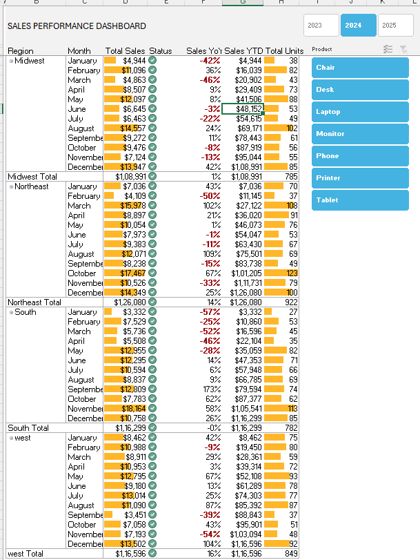
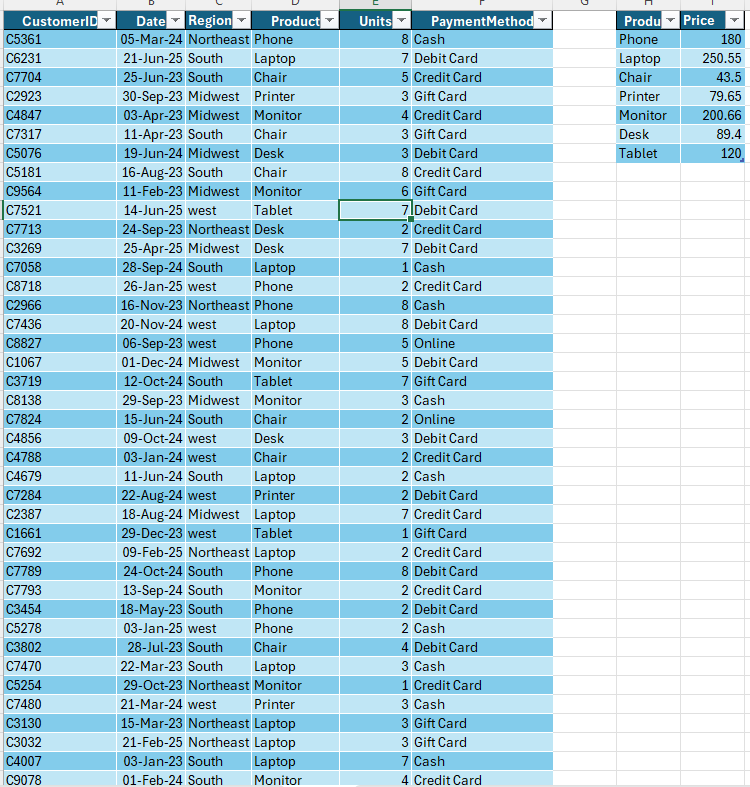

# Sales Performance Analytics Dashboard
An Excel sales analysis project built with Power Pivot. The dashboard summarizes sales performance across regions, months, products, and years.
## Dashboard features
- Total sales and units sold by region and month
- Year-over-year sales comparison
- Year and product filters
- Regional and monthly summaries
- Sales analysis based on transaction and product price data
## Preview

## Key insights
- **West has the highest displayed regional total:** $116,296, compared with $108,991 for Midwest, $126,080 for Northeast, and $116,299 for South. (Correction: Northeast is highest at $126,080.)
- **South and West are nearly tied:** South totals $116,299, just $3 above West at $116,296.
- **Northeast has the highest total units:** 922, compared with 785 for Midwest, 782 for South, and 849 for West.
- **Monthly sales vary considerably.** Midwest peaks at $14,557 in August and is lowest at $6,645 in June. Northeast peaks at $17,467 in October and is lowest at $7,036 in January.
- **Year-over-year results are mixed.** The dashboard shows both positive and negative monthly changes across regions, so performance varies by region and month.
- **The largest visible monthly sales figure is $17,467** for Northeast in October. The smallest is $3,332 for South in January.
## Project structure
- `dashboard/Sales_Performance_Dashboard.xlsx` — Excel dashboard and Power Pivot model
- `images/sales-dashboard-preview.png` — dashboard screenshot
- `images/sales-data-preview.png` — source data screenshot
- `docs/user-guide.pdf` — optional usage guide
## Data fields
The transaction preview includes customer ID, date, region, product, units, and payment method. The product price list maps products to prices. Sales can be calculated from units and product price.
## How to use
1. Download the Excel workbook from the `dashboard` folder.
2. Open it in Microsoft Excel.
3. Enable editing or refresh the data if prompted.
4. Use the year and product filters to explore sales.
5. Refresh the PivotTables or Power Pivot model after updating the source data, if needed.   
## Requirements
- Microsoft Excel with Power Pivot support for full model functionality
## Privacy
Use sample or anonymized customer information. Do not publish real personal, payment, or confidential business data.
## Author
Rohit Bhagat
